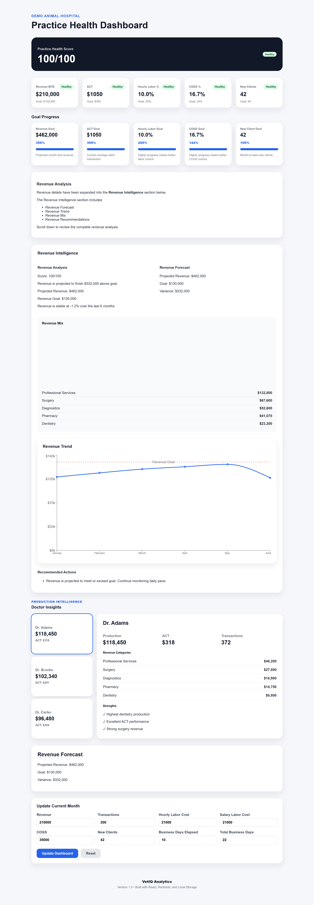
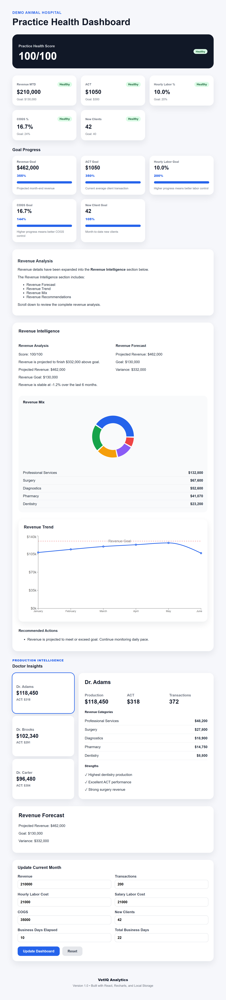

# VetIQ Analytics

**Veterinary business intelligence and decision-support dashboard**

🌐 **[Live Demo](https://vet-iq-analytics.vercel.app/)** · 💻 **[Source Code](https://github.com/tracycrossrvt-gif/VetIQ-Analytics)**

VetIQ Analytics is a responsive React application that helps veterinary practice leaders make sense of operational and financial performance. It brings key metrics, revenue patterns, and doctor-level insights into one interactive dashboard, with recommendations intended to help identify areas worth investigating.

## Why I built it

My experience leading veterinary hospital operations showed me how difficult it can be to turn separate reports and metrics into actionable decisions. I designed VetIQ around the questions practice leaders routinely ask: Are we meeting our goals? Where is revenue changing? Which performance indicators deserve attention?

The aim is to make those questions easier to explore through a clear interface—not to replace professional judgment.

## Features

- **Practice health overview:** composite health score, KPI cards, goal progress, and forecasting
- **Revenue intelligence:** revenue trends, category mix, interactive charts, and recommendations
- **Doctor insights:** production, average client transaction (ACT), transaction volume, and category breakdowns
- **Interactive exploration:** clickable KPIs and a dynamic analysis panel
- **Data entry:** monthly input form with validation, local persistence, and reset functionality
- **Responsive dashboard:** layouts for desktop, tablet, and mobile screens

## Technology

- React and JavaScript (ES6+)
- Vite
- Recharts for data visualization
- CSS3
- Browser `localStorage` for persistence

## Engineering and product decisions

- Organized metrics into a dashboard hierarchy so users can move from an overall health view to more specific operational drivers.
- Used derived calculations and data visualizations to convert raw values into comparisons and trends.
- Added input validation and local persistence so users can explore data without requiring an account or backend service.
- Designed the experience around veterinary workflows and familiar practice KPIs rather than generic analytics terminology.

**Scope:** This is a portfolio application with browser-local data, not a production integration with practice-management software. Forecasts, scores, and recommendations are decision-support features and should be interpreted in context.

## Screenshots

### Desktop


### Tablet



### Mobile


## Run locally

```bash
npm install
npm run dev
```

For code-quality and production-build checks:

```bash
npm run lint
npm run build
```

## Future directions

**Near-term exploration:** practice benchmarking, doctor production trends, inventory analytics, revenue by service category, exports, and visual refinements.

**Longer-term possibilities:** cloud storage, authentication, multi-practice support, practice-management integrations, scheduling and payroll analytics, and AI-assisted operational insights.

These are potential extensions, not features claimed to be complete.

## About the developer

**Tracy Cross** — Software Developer with a background in veterinary operations and business leadership.

[Portfolio](https://dev-portfolio-woad-seven.vercel.app/) · [LinkedIn](https://www.linkedin.com/in/tracy-cross-dev/) · [GitHub](https://github.com/tracycrossrvt-gif)
